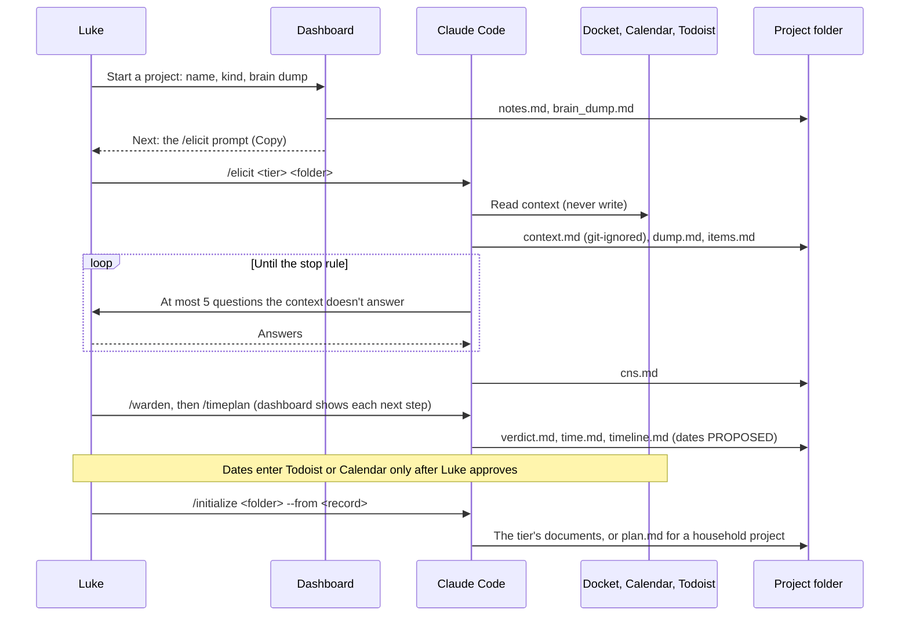

# SE-02 Concept of Operations

**Status: DRAFT,** current to D-044 (2026-10-09). AI-drafted by Claude from Luke's direction. Explain-backs on SE documents are waived (D-029). Every behavior is `PROPOSED` unless it cites a D-nnn decision.

How Luke uses the library and the dashboard. SE-03 turns the behaviors into requirements.

## 1. The scene

- **A new idea.** It used to go to Claude as a few lines, and Claude drafted the SE set, filling the gaps with unmarked inference (this project's own 10/6 set is the example).
- **A household project** (D-014): the attic, the bedroom, packing to move. No code; Luke wants "just a folder with some markdown for me to read or print out paper".
- **A project already underway** whose AI-drafted SE set was never checked against Luke's words (the four older projects).
- **A project ending:** done, demoed, due, or Luke has learned enough (D-031). Closeouts used to be ad hoc.

Now each starts on the dashboard, which shows the next step and the prompt to paste into Claude.

## 2. Actors and roles

| Actor | Role | Holds | Trusted? |
|---|---|---|---|
| **Luke** | Decides, reviews, answers explain-backs, sets dates in Todoist | Every decision | Yes |
| **Claude Code** | Runs the skills; drafts | The repo it runs in | Output is `PROPOSED` until Luke reviews it (R2) |
| **Skills** | The library's nine skills (§3) | Instructions, scripts, templates | Only `ACCEPTED` and unchanged skills leave this repo (SAFE-03, D-044) |
| **Elicitation record** | `docs/se/elicitation/<date>/` (or `elicitation/<date>/` in a Hands-on folder): dump, items, rounds, weights, CNS, verdict | Luke's words; Claude's inferences and Luke's context, each tagged as such | Stated items: yes. Inferred: until Luke confirms. Context: as of its source date |
| **Docket, Calendar, Todoist** | Luke's context: what else is going on (D-039) | Areas, decisions, commitments, tasks | Read only, never written; copied into a git-ignored `context.md` |
| **Dashboard** | A local web page (127.0.0.1 only) of projects, states, next steps and shelves. It writes `notes.md`, `brain_dump.md` and a new project's folder, the archive list, and installs accepted skills into `~/.claude/skills` (D-034, D-038, D-041, D-042, D-044) | Files it reads from the project folders | Every write comes from Luke's click; forms need a per-run token |
| **Hooks** | The privacy pre-push hook (D-033) | A script | Runs without asking; blocks, never edits |
| **Collaborators, the lab** | Their own work; the lab is an audience (#4) | Their work | Never enters the library (SAFE-02) |

## 3. Skills

The 10/6 inventory of Luke's existing workflows is in commit `6c0e9c1` (SE-02 §3 there). What came of it:

| Skill | What it does | Status (D-044) |
|---|---|---|
| `/elicit` | Loads Luke's context, takes one brain dump, extracts tagged items, probes to saturation, weights, prioritizes, writes the CNS; reconciles an existing SE set | `ACCEPTED` (D-045) |
| `/warden` | Go, shrink or no-go, with reasons; proposes rescopes | `ACCEPTED` (D-045) |
| `/timeplan` | Suggested hours (time equation) and a proposed timeline; records actual hours | `ACCEPTED` |
| `/initialize` | The tier's documents, or a printable household folder; only for elicited, gated projects | `ACCEPTED` (D-045) |
| `/privacy` | Pre-push hook against private terms and secrets; full-history scan | `ACCEPTED` (D-045) |
| `/se-audit` | Fresh-agent audit of an SE set | `ACCEPTED` |
| `/closeout` | Closeout counts from the record; asks the closing questions; never writes Luke's statement | `ACCEPTED` (D-045) |
| `/healthcheck` | Checks the library still works and that accepted skills are unchanged; fixes nothing | `ACCEPTED` (D-045) |
| `/selftest` | Opt-in how-and-why questions on a project | `ACCEPTED` (D-045) |

## 4. Operating modes

| Mode | Luke wants to | What happens | Output |
|---|---|---|---|
| **Elicit** (D-010, D-039, D-040) | Get a project written down | Context loads first; Luke's one message is the dump; Claude asks only about gaps the context doesn't answer | Elicitation record and `cns.md` |
| **Gate** (D-015, D-022) | Know if it's worth it, and how much | The warden's verdict; the time equation's hours; a proposed timeline that enters Todoist or Calendar only after Luke approves | Verdict, hours, proposed dates |
| **Initialize** (D-028, D-032) | Set it up | Only for an elicited, gated project: the tier's documents or a household folder, one rules file, accepted skills | The project's files, all `PROPOSED` |
| **Build** | Do the work | Outside the library; the dashboard shows state and next step | — |
| **Wrap up and Conclude** (D-023, D-031) | Close it, for any reason | On Luke's word, or Claude asks once on burnout signs. The closeout tool gathers counts and asks the closing questions; Luke writes the statement, lessons and interpretation | A filed closeout; the project moves to Completed |
| **Adopt, Maintain** | Add a skill to an old repo; update copies | Deferred (D-027, D-044); installs are pinned copies refreshed by the installer | — |

### Tiers (D-006)

| Tier | Fits | Documents | Audit |
|---|---|---|---|
| **Immediate** | A task of days | A README goal and done-when line (D-028); a household `plan.md` | none |
| **Short** | Weeks | SE-00 to SE-03 | offered |
| **Long** | Months | SE-00 to SE-07 | required before build |

A project moves up a tier by a decision-log entry; the initializer adds only the missing documents, never down (D-044). The time suggestion proposes a tier, and Luke picks it.

## 5. Use cases

| UC | Trigger | Outcome | Mode |
|---|---|---|---|
| **UC-2** Initialize a project | An elicited, gated project | The tier's documents and accepted skills; no git action without approval | Initialize |
| **UC-3** Adopt a skill | Luke wants a skill in an old repo | `/initialize` or the installer adds it, if accepted | Adopt |
| **UC-4** Update everywhere | A skill is fixed here | It is re-accepted, and the installer refreshes the pinned copies | Maintain |
| **UC-5** Harvest a skill | A closeout finds a reusable workflow | Drafted into the library, `PROPOSED` until its explain-back | Conclude |
| **UC-6** Leak blocked | A file to be pushed holds a private term | The push is refused, and the hit is listed by file and label | — |
| **UC-7** Review a skill | A skill is drafted or changed | Luke answers its explain-back; only then can it leave the repo | All |
| **UC-8** Audit a set | An SE set is drafted | A fresh agent writes a findings report | Initialize |
| **UC-9** Pick a tier | A project is gated | The time suggestion proposes a tier; the initializer writes exactly that tier | Gate, Initialize |
| **UC-10** Promote a project | A project grows | A decision, then only the missing documents | Initialize |
| **UC-12** Conclude a project | It's done, demoed, due, or learned | Counts from recorded files; Luke's answers verbatim; a git tag proposed, never created without Luke (CLOSE-05) | Conclude |
| **UC-13** Dump and extract | A project in mind | Context loaded; the dump saved verbatim; items tagged stated, inferred or context | Elicit |
| **UC-14** Probe to saturation | Gaps remain | Rounds of at most five questions until the stop rule | Elicit |
| **UC-15** Weight and prioritize | More pieces than hours | Swing weights and a robust pick within the budget | Elicit |
| **UC-16** Reconcile an AI-drafted set | An existing SE set | Each requirement traced to Luke's words, or marked Claude's | Elicit |
| **UC-17** Gate a project | Elicitation done | Go, shrink or no-go with E-id reasons; a no-go stops initialization unless overridden | Gate |
| **UC-18** Suggest time and timeline | The warden said go | Suggested hours; proposed dates entered only after approval; actual hours compared later | Gate |
| **UC-19** Household project | The attic | A printable Markdown folder, no git | Initialize |
| **UC-20** Wrap up | Luke's word, or burnout signs and Luke's yes | A plan that fits the time left and ends in a closeout | Wrap up |
| **UC-21** Health check | Monthly, or a tool changed | The library's checks run; changed accepted skills are flagged; nothing is fixed without Luke | Maintain |

UC-1 (Learn) was dropped by D-021, and UC-11 (Analyze) by D-037. UC-3, UC-12, UC-20 and UC-21 are covered only by deferred requirements until G1 (SE-03).

## 6. Example sequence: a new project from the dashboard

## 7. Assumptions and constraints

- Side work, behind the thesis and coursework (D-004).
- Luke is the user, the sponsor, the developer and the tester at once, so the record has to separate what Luke said from what Claude inferred.
- The DoD framework behind `/elicit` (D-011) is summarized in [reference_dod_5000-87.md](reference_dod_5000-87.md).

---

**Explain-back (Luke):** Walk through UC-6 for the privacy check: what gets copied, what stays specific to the project, and how would you know the hook actually runs?

> *(Waived by D-029.)*
